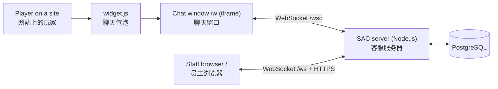
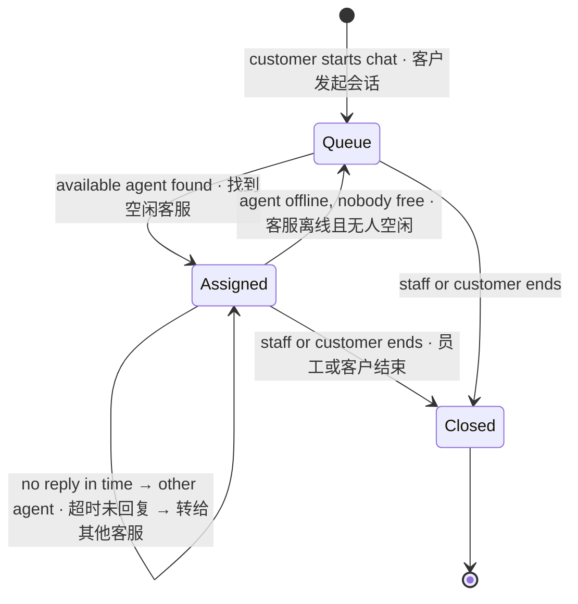

# SAC Multilinha — Technical Document · 技术文档

| | |
| --- | --- |
| **Author · 作者** | 维尼 |
| **Version · 版本** | 1.0 |
| **Date · 日期** | 2026-11-21 |
| **Repository · 代码仓库** | https://github.com/Yamargo/sacia |
| **Languages · 语言** | English · 中文 (each section is written in English first, then Chinese · 每节先英文，后中文) |

---

## Contents · 目录

1. [Purpose and intent · 项目目的与意图](#1-purpose-and-intent--项目目的与意图)
2. [Product versions · 产品版本](#2-product-versions--产品版本)
3. [Architecture · 系统架构](#3-architecture--系统架构)
4. [Roles and permissions · 角色与权限](#4-roles-and-permissions--角色与权限)
5. [Company lines · 公司线路](#5-company-lines--公司线路)
6. [Chat lifecycle and routing · 会话生命周期与分配](#6-chat-lifecycle-and-routing--会话生命周期与分配)
7. [Supervisor alerts · 主管警报](#7-supervisor-alerts--主管警报)
8. [Agent workspace · 客服工作台](#8-agent-workspace--客服工作台)
9. [Settings · 设置](#9-settings--设置)
10. [Languages · 多语言](#10-languages--多语言)
11. [Customer widget and integration · 客户组件与接入](#11-customer-widget-and-integration--客户组件与接入)
12. [Server, API and real-time protocol · 服务器、接口与实时协议](#12-server-api-and-real-time-protocol--服务器接口与实时协议)
13. [Data model · 数据模型](#13-data-model--数据模型)
14. [Security · 安全](#14-security--安全)
15. [Deployment · 部署](#15-deployment--部署)
16. [Development and testing · 开发与测试](#16-development-and-testing--开发与测试)
17. [Limits and defaults · 限制与默认值](#17-limits-and-defaults--限制与默认值)
18. [Known limitations and roadmap · 已知限制与路线图](#18-known-limitations-and-roadmap--已知限制与路线图)

---

## 1. Purpose and intent · 项目目的与意图

**EN.** SAC Multilinha is a customer-support platform for online gaming sites such as 7987.com and 8557.com. One team serves many sites ("lines") from one inbox. The project has five goals:

1. **Fast replies.** Each chat goes automatically to an available agent on the right line. If the agent does not answer in time, the chat moves to another agent.
2. **Clear control.** Four access levels (God, Admin, Supervisor, Agent) decide who manages people, lines and chats.
3. **Visibility for leaders.** Supervisors see who is online, take over or transfer chats, and get a sound alert when a customer waits too long.
4. **Customers first on mobile.** Players use a chat widget built for phones, in Vietnamese, Roman Urdu, English or Chinese, their choice.
5. **Simple to install.** A site adds one line of code to show the chat bubble.

**中文。** SAC Multilinha 是一个面向在线游戏网站（例如 7987.com、8557.com）的客服平台。一个团队通过同一个收件箱服务多个网站（即“线路”）。项目有五个目标：

1. **快速回复。** 每个会话自动分配给对应线路上的空闲客服。如果客服未及时回复，会话会转给其他客服。
2. **清晰的管控。** 四种权限级别（God、管理员、主管、客服）决定谁可以管理人员、线路和会话。
3. **管理者可见性。** 主管可以看到谁在线，接手或转接会话，并在客户等待过久时收到声音警报。
4. **移动端优先。** 玩家使用专为手机设计的聊天组件，可自行选择越南语、罗马乌尔都语、英语或中文。
5. **易于接入。** 网站只需加入一行代码即可显示聊天气泡。

---

## 2. Product versions · 产品版本

**EN.** The repository contains two versions built from the same interface code.

**中文。** 代码仓库包含两个版本，它们使用同一套界面代码构建。

| Version · 版本 | Folder · 目录 | Data storage · 数据存储 | Use · 用途 |
| --- | --- | --- | --- |
| Server · 服务器版 | `server/` | PostgreSQL | Production: real customers, many staff on different computers · 正式环境：真实客户、多名员工在不同电脑上使用 |
| Prototype · 原型版 | `prototype/` | Browser `localStorage` · 浏览器本地存储 | Demos and screen tests; runs as a single HTML file · 演示与界面测试；单个 HTML 文件即可运行 |

**EN.** `prototype/src/build.py` generates both: `prototype/index.html` (prototype) and `server/public/*` (server pages, widget and demo). The file `net.js` is added only to the server build and connects the interface to the server.

**中文。** `prototype/src/build.py` 同时生成两个版本：`prototype/index.html`（原型版）和 `server/public/*`（服务器页面、组件和演示页）。`net.js` 只加入服务器版，用于把界面连接到服务器。

---

## 3. Architecture · 系统架构



**EN.**

- **`widget.js`.** Runs on the customer's site. It draws the bubble, opens the chat window in an iframe and exposes the `SAC` JavaScript API.
- **Chat window (`/w`).** The customer UI: language choice, start form, messages, attachments, end chat. It talks to the server over the `/wsc` WebSocket.
- **SAC app (`/`).** The staff UI: inbox, team, users, simulator, alerts, integration guide and settings. It talks to the server over the `/ws` WebSocket after login.
- **Server.** Node.js with Express (HTTP) and `ws` (WebSocket). All rules run on the server: permissions, routing, automatic transfers and alerts data. State is kept in memory and written to PostgreSQL after every change.
- **Live updates.** After any change the server sends each connected person their own filtered view of the data (grouped every 60 ms).

**中文。**

- **`widget.js`。** 运行在客户网站上。它负责显示聊天气泡，在 iframe 中打开聊天窗口，并提供 `SAC` JavaScript 接口。
- **聊天窗口（`/w`）。** 客户界面：选择语言、开始表单、消息、附件、结束会话。通过 `/wsc` WebSocket 与服务器通信。
- **SAC 应用（`/`）。** 员工界面：收件箱、团队、用户、模拟器、警报、接入指南和设置。登录后通过 `/ws` WebSocket 与服务器通信。
- **服务器。** 基于 Node.js，使用 Express（HTTP）和 `ws`（WebSocket）。所有规则都在服务器上执行：权限、分配、自动转接和警报数据。数据保存在内存中，每次变更后写入 PostgreSQL。
- **实时更新。** 每次变更后，服务器向每位在线人员发送其权限范围内的数据视图（每 60 毫秒合并发送一次）。

---

## 4. Roles and permissions · 角色与权限

| Action · 操作 | God (Full access · 最高权限) | Admin · 管理员 | Supervisor · 主管 | Agent · 客服 |
| --- | :-: | :-: | :-: | :-: |
| Reply to customers · 回复客户 | ✓ | ✓ | ✓ (own lines · 本人线路) | ✓ (assigned chats · 分配给自己的会话) |
| Take over a chat · 接手会话 | ✓ | ✓ | ✓ (own lines) | — |
| Transfer a chat · 转接会话 | ✓ | ✓ | ✓ (own lines) | ✓ (own chats, to online agents · 自己的会话，转给在线客服) |
| End a chat · 结束会话 | ✓ no reason · 无需理由 | ✓ no reason | ✓ no reason | ✓ written reason (min. 5 chars) · 必须填写理由（至少 5 个字符） |
| See who is online · 查看在线人员 | ✓ all · 全部 | ✓ all | ✓ agents of own lines · 本人线路的客服 | ✓ agents · 客服 |
| Disconnect a person · 强制下线 | ✓ | ✓ (not God · God 除外) | ✓ (agents only · 仅客服) | — |
| Change another person's password · 修改他人密码 | ✓ | ✓ (not God) | ✓ (agents only) | — |
| Create, edit, delete access · 创建、编辑、删除账号 | ✓ | ✓ (not God) | — | — |
| Manage company lines · 管理公司线路 | ✓ | ✓ | — | — |
| Reply-timeout, delay-alert and chat-limit settings · 回复时限、延迟警报、会话上限设置 | ✓ | ✓ | — | — |
| Alerts page and sound · 警报页面与声音 | ✓ all lines · 所有线路 | — | ✓ own lines · 本人线路 | — |
| Integration guide · 接入指南 | ✓ | ✓ | — | — |
| Pause, logout, own password, language · 暂停、退出、修改本人密码、语言 | ✓ | ✓ | ✓ | ✓ |

**EN.** Visibility of chats: agents see chats assigned to them or that they handled before; supervisors see all chats of their lines; Admin and God see all chats. Agents do not receive other people's email addresses.

**中文。** 会话可见范围：客服只能看到分配给自己或自己曾经接待过的会话；主管可以看到本人线路的所有会话；管理员和 God 可以看到全部会话。客服不会收到其他人员的邮箱地址。

---

## 5. Company lines · 公司线路

**EN.** A line is one company or site. It has:

- a **code**: 2–20 letters, digits or hyphens, unique, and it cannot change;
- a **name**, for example `7987.com`;
- a **color** for its label: mint, ink, lilac, peach, sky, sun, rose or stone.

God and Admin create, edit and delete lines in *Settings → Company lines*. A line with open chats cannot be deleted. When a line is created, every God and Admin account gets it automatically. Agents and supervisors receive lines when their access is created or edited. The two default lines are `7987` and `8557`.

**中文。** 一条线路代表一家公司或一个网站，包括：

- **代码**：2–20 个字母、数字或连字符，唯一，创建后不可修改；
- **名称**，例如 `7987.com`；
- **颜色**，用于标签：mint、ink、lilac、peach、sky、sun、rose 或 stone。

God 和管理员可在“设置 → 公司线路”中创建、编辑和删除线路。有进行中会话的线路不能删除。新建线路时，所有 God 和管理员账号会自动获得该线路。客服和主管的线路在创建或编辑其账号时分配。默认线路为 `7987` 和 `8557`。

---

## 6. Chat lifecycle and routing · 会话生命周期与分配



**EN.**

1. **Creation.** A chat starts from the widget (source "site") or the staff simulator (source "sim"). It receives a sequential six-digit ID starting at `#000000`.
2. **Routing.** The server looks for agents of the chat's line who are online, not paused and below the chat limit. The chat goes to the one with the fewest open chats. If nobody qualifies, the chat waits in the queue (*Unassigned*) and is assigned as soon as someone is free.
3. **Reply timeout (default 240 s / 4 min).** The clock starts when the customer writes and is cleared when staff replies. When it runs out, the chat moves to another available agent of the same line, and the clock restarts.
4. **Offline agent.** An agent counts as offline 20 seconds after their last connection closes. Their open chats go to another available agent or back to the queue.
5. **Take over and transfer.** God, Admin and Supervisor can take over any chat they can act on. Agents can transfer their own chats to available agents of the same line.
6. **Ending.** An agent must write a reason; other roles may leave it empty. The customer can also end the chat from the widget and start a new one from scratch.
7. **System messages** record every event: assigned, transferred, timeout, offline, taken over, ended. They are stored as translation keys, so each reader sees them in their own language.

**中文。**

1. **创建。** 会话由组件发起（来源 “site”）或由员工模拟器创建（来源 “sim”），并获得从 `#000000` 开始递增的六位编号。
2. **分配。** 服务器在该线路中查找在线、未暂停且未达会话上限的客服，并分配给进行中会话最少的人。如果没有符合条件的客服，会话进入排队（“未分配”），一旦有人空闲即自动分配。
3. **回复时限（默认 240 秒 / 4 分钟）。** 客户发消息时开始计时，员工回复后清零。超时后，会话转给同一线路的其他空闲客服，并重新计时。
4. **客服离线。** 客服最后一个连接断开 20 秒后视为离线，其进行中的会话会转给其他空闲客服或退回排队。
5. **接手与转接。** God、管理员和主管可以接手其有权处理的任何会话。客服可以把自己的会话转给同一线路的空闲客服。
6. **结束。** 客服结束会话时必须填写理由，其他角色可不填。客户也可以在组件中结束会话，并重新发起新的对话。
7. **系统消息** 记录所有事件：分配、转接、超时、离线、接手、结束。系统消息以翻译键保存，每位读者都会看到自己语言的版本。

---

## 7. Supervisor alerts · 主管警报

**EN.**

- **Who and when.** Supervisors (for their lines) and God (for all lines) are alerted when a customer has waited longer than the delay-alert time (default 300 s / 5 min) without a staff reply.
- **Not reset by transfers.** This clock is separate from the reply timeout: it starts at the first unanswered customer message and is not reset by transfers. It ends when staff replies or the chat ends.
- **Alerts page.** Shows each waiting chat with a live timer, customer, line, current agent, last customer message, *Open chat* and *Got it*.
- **Sound.** A new alert plays three double beeps. While any alert is not marked *Got it*, a reminder plays every minute. Muted chats do not ring.
- **Browser rule.** Browsers only allow sound after the person clicks: the page has *Turn on sound* and *Test sound*, and after a reload one click anywhere re-enables it. The tab title shows the count, for example `(2) SAC`.

**中文。**

- **对象与时机。** 当客户等待超过“延迟警报”时间（默认 300 秒 / 5 分钟）仍未收到员工回复时，主管（本人线路）和 God（所有线路）会收到警报。
- **不受转接影响。** 此计时与“回复时限”分开：从第一条未回复的客户消息开始，转接不会清零，员工回复或会话结束时停止。
- **警报页面。** 显示每个等待中的会话：实时计时、客户、线路、当前客服、客户最后一条消息，以及“打开会话”和“知道了”按钮。
- **声音。** 新警报会播放三次双音提示；只要还有未点击“知道了”的警报，每分钟会再提醒一次。已静音的会话不会响铃。
- **浏览器规则。** 浏览器只有在用户点击后才允许播放声音：页面提供“开启声音”和“测试声音”，刷新后在任意位置点击一次即可恢复。标签页标题会显示数量，例如 `(2) SAC`。

---

## 8. Agent workspace · 客服工作台

**EN.**

- **Folders.** Mine, Unassigned, Team, Muted, All. Agents see Mine, Muted and All. The panel can collapse to icons.
- **Quick tabs.** All, Unread, Pending reply.
- **Filters.** Line, status (open/ended), agent, customer language and period (today / last 7 days).
- **"…" menu.** Mark all as read; sort by newest, oldest or longest wait; show or hide the folders panel.
- **Search.** Chat ID, name, phone, player ID or message text. A query starting with `#` searches only IDs, for example `#000123`.
- **Conversation.** Header with chat ID (click to copy), customer language, mute, take over, transfer and end. Customer details panel, or the ⓘ button on smaller screens.
- **Composer.** Personal scripts (ready replies), attachments up to 10 MB, Enter to send and Shift+Enter for a new line.
- **Notifications.** A beep for a new chat or message in my chats, an unread counter in the tab title, and toasts.
- **Side bar.** Status button (green = available, yellow = paused) for every role, and a logout button with confirmation.

**中文。**

- **文件夹。** 我的、未分配、团队、已静音、全部。客服只看到“我的”“已静音”“全部”。面板可收起为图标。
- **快捷标签。** 全部、未读、待回复。
- **筛选。** 线路、状态（进行中/已结束）、客服、客户语言、时间（今天/最近 7 天）。
- **“…”菜单。** 全部标为已读；按最新、最早或等待最久排序；显示或隐藏文件夹面板。
- **搜索。** 支持会话 ID、姓名、电话、玩家 ID 或消息内容。以 `#` 开头只搜索 ID，例如 `#000123`。
- **会话页面。** 顶部显示会话 ID（点击复制）、客户语言、静音、接手、转接、结束。另有客户详情面板，小屏幕上为 ⓘ 按钮。
- **输入区。** 个人话术（快捷回复）、最大 10 MB 的附件，Enter 发送，Shift+Enter 换行。
- **通知。** 我的会话有新会话或新消息时响铃，标签页标题显示未读数，并弹出提示。
- **侧边栏。** 所有角色都有状态按钮（绿色 = 空闲，黄色 = 暂停），以及带确认的退出按钮。

---

## 9. Settings · 设置

| Setting · 设置项 | Who · 谁可修改 | Default · 默认值 | Range · 范围 |
| --- | --- | --- | --- |
| Interface language · 界面语言 | Everyone · 所有人 | Português | pt, en, vi, ur, zh |
| Profile name · 显示名称 | Everyone | — | up to 80 chars · 最多 80 字符 |
| Own password · 本人密码 | Everyone | — | min. 6 chars · 至少 6 字符 |
| Notification sound · 通知声音 | Everyone (per browser · 按浏览器保存) | On · 开启 | On/Off |
| Company lines · 公司线路 | God, Admin | 7987, 8557 | unlimited · 不限 |
| Chat limit per agent · 每位客服会话上限 | God, Admin | 0 (no limit · 不限) | 0–50 |
| Delay alert · 延迟警报 | God, Admin | 300 s | 30–7200 s |
| Reply timeout · 回复时限 | God, Admin | 240 s | 10–3600 s |

---

## 10. Languages · 多语言

**EN.**

- **Staff interface:** Portuguese, English, Vietnamese, Roman Urdu and Chinese. The choice is saved to the user's account.
- **Customer widget:** Vietnamese, Roman Urdu, English and Chinese, chosen by the customer on first open. The choice is saved in their browser and sent to the server, so staff see "Customer language" in the chat.
- **Translations.** All texts live in `prototype/src/tr.txt`, one line per text in the format `pt || en || vi || ur || zh`. The build fails the check (`missing`) if any text used in code has no translation.
- **Chat content** is not translated automatically; see the roadmap.

**中文。**

- **员工界面：** 葡萄牙语、英语、越南语、罗马乌尔都语和中文。选择保存在用户账号中。
- **客户组件：** 越南语、罗马乌尔都语、英语和中文，由客户首次打开时选择。选择保存在客户浏览器中并发送给服务器，员工可在会话中看到“客户语言”。
- **翻译。** 所有文本都在 `prototype/src/tr.txt` 中，每行一条，格式为 `pt || en || vi || ur || zh`。如果代码中使用的文本缺少翻译，构建检查会提示 `missing`。
- **聊天内容** 目前不会自动翻译，见路线图。

---

## 11. Customer widget and integration · 客户组件与接入

### 11.1 Installation · 安装

```html
<script src="https://YOUR-SAC/widget.js"
        data-linha="7987"
        data-idioma="auto"
        data-posicao="direita"
        async></script>
```

**EN.** Paste before `</body>` on every page. The *Integration* page in the SAC (God/Admin) generates this code with the real server address and explains where to paste it on a gaming back office, WordPress, Google Tag Manager or a custom HTML/React site.

**中文。** 粘贴到每个页面的 `</body>` 之前。SAC 中的“接入”页面（God/管理员）会使用真实服务器地址生成此代码，并说明在游戏平台后台、WordPress、Google Tag Manager 或自建 HTML/React 网站中的粘贴位置。

| Attribute · 属性 | Values · 取值 | Default · 默认 | Meaning · 含义 |
| --- | --- | --- | --- |
| `data-linha` | line code · 线路代码 | — (required · 必填) | Which line receives the chats · 接收会话的线路 |
| `data-idioma` | `auto`, `vi`, `ur`, `en`, `zh` | `auto` | Fixed language, or customer chooses · 固定语言或由客户选择 |
| `data-posicao` | `direita`, `esquerda` | `direita` | Bubble on the right or left · 气泡在右侧或左侧 |

### 11.2 JavaScript API · JavaScript 接口

| Command · 命令 | Effect · 作用 |
| --- | --- |
| `SAC.open()` / `SAC.close()` | Open or close the chat · 打开或关闭聊天 |
| `SAC.identify({ id, nome })` | Send the logged-in player's ID and name · 发送已登录玩家的 ID 和姓名 |
| `SAC.setLanguage("vi")` | Change the widget language · 切换组件语言 |
| `window.SAC = { jogador: { id, nome } }` (before the script · 在脚本之前) | Same as `identify`, at page load · 页面加载时识别玩家 |

### 11.3 How it works · 工作方式

**EN.**

- **Bubble and window.** `widget.js` adds a 60 px bubble and a 370×560 px panel holding an iframe of `/w`. On screens ≤ 600 px the panel is full screen and the page behind stops scrolling.
- **Messages between site and window.** The site and the iframe talk with `postMessage`, checked by origin. Message types: `ready`, `open`, `close`, `unread` (bubble badge), `player`, `lang`.
- **Returning customers.** When a chat starts, the server returns a random token. The window keeps it in `localStorage` (`sac_tok_<line>`) so the customer finds the conversation again after a reload. The server stores only its SHA-256 hash.
- **Demo page.** `/demo/<line>` is a fictional gaming page with the real widget installed, for testing.

**中文。**

- **气泡与窗口。** `widget.js` 会添加一个 60 像素的气泡和一个 370×560 像素的面板，面板内是 `/w` 的 iframe。屏幕宽度 ≤ 600 像素时面板全屏显示，背后的页面停止滚动。
- **网站与窗口之间的消息。** 网站与 iframe 通过 `postMessage` 通信，并校验来源。消息类型：`ready`、`open`、`close`、`unread`（气泡角标）、`player`、`lang`。
- **回访客户。** 会话开始时服务器返回一个随机令牌，窗口将其保存在 `localStorage`（`sac_tok_<线路>`）中，客户刷新后仍可找回会话。服务器只保存该令牌的 SHA-256 哈希值。
- **演示页。** `/demo/<线路>` 是一个安装了真实组件的虚构游戏页面，用于测试。

---

## 12. Server, API and real-time protocol · 服务器、接口与实时协议

### 12.1 HTTP routes · HTTP 路由

| Route · 路由 | Purpose · 用途 |
| --- | --- |
| `GET /` | SAC staff app · 员工应用 |
| `POST /api/login` | `{email, password}` → session cookie `sac_s` · 登录并设置会话 Cookie |
| `POST /api/logout` | End session · 退出登录 |
| `GET /api/me` | Is the session valid? · 会话是否有效 |
| `GET /widget.js` | Widget loader (CORS `*`, cache 5 min) · 组件加载脚本（允许跨域，缓存 5 分钟） |
| `GET /w` | Customer chat window · 客户聊天窗口 |
| `GET /demo/:line` | Demo site · 演示网站 |
| `GET /files/:id` | Attachments (unguessable IDs) · 附件（不可猜测的 ID） |
| `GET /healthz` | Health check · 健康检查 |

### 12.2 WebSocket

**EN.** Staff connect to `/ws` (requires the session cookie). Customers connect to `/wsc?line=<code>&token=<token>`. Both accept connections only from the server's own origin. The server pings every 25 s.

**中文。** 员工连接 `/ws`（需要会话 Cookie），客户连接 `/wsc?line=<代码>&token=<令牌>`。两者都只接受来自服务器自身域名的连接。服务器每 25 秒发送一次心跳。

| Direction · 方向 | Message · 消息 | Meaning · 含义 |
| --- | --- | --- |
| server → staff | `{t:'state', state}` | Filtered snapshot: me, users, presence, chats, scripts, lines, settings · 过滤后的数据快照 |
| server → customer | `{t:'cstate', state}` | Own chat, line name, available agents · 本人会话、线路名称、空闲客服数 |
| client → server | `{t:'cmd', id, cmd, args}` | Command · 命令 |
| server → client | `{t:'res', id, ok, data \| error}` | Command result (error = translation key) · 命令结果（错误为翻译键） |
| server → staff | `{t:'bye', reason}` | `kicked`, `password`, `removed` → back to login · 返回登录页 |

### 12.3 Commands · 命令

| Staff command · 员工命令 | Effect · 作用 |
| --- | --- |
| `send`, `take`, `transfer`, `close` | Reply (text/file), take over, transfer, end · 回复、接手、转接、结束 |
| `read`, `readAll`, `mute`, `pause` | Read marks, mute chat, pause status · 已读、静音、暂停 |
| `setLang`, `profile`, `ownPass` | Own preferences · 个人设置 |
| `userCreate`, `userEdit`, `userDel`, `setPass`, `kick` | People management · 人员管理 |
| `lineCreate`, `lineEdit`, `lineDel`, `cfg` | Lines and settings · 线路与设置 |
| `scriptSave`, `scriptDel` | Personal scripts · 个人话术 |
| `simNew`, `simMsg` | Simulator · 模拟器 |

| Customer command · 客户命令 | Effect · 作用 |
| --- | --- |
| `start {name, pid, msg, lang, player}` | New chat → returns token · 新会话，返回令牌 |
| `send {text, file}` | Message or attachment · 发送消息或附件 |
| `lang {lang}` | Change language · 切换语言 |
| `end` | Customer ends the chat · 客户结束会话 |

---

## 13. Data model · 数据模型

| Table · 表 | Content · 内容 |
| --- | --- |
| `users` | `{id, name, email, pass (bcrypt), role, lines[], lang, muted[], read{chatId: time}, createdAt}` |
| `lines` | `{id, name, color, pos}` |
| `chats` | `{id, no, line, source, customer{name, phone, pid, lang}, status, agentId, handled[], createdAt, assignedAt, waiting, custWait, transfers, closedAt, closedBy, closeReason, ctok, msgs[]}` + columns `no`, `status`, `updated_at` |
| `msgs` (inside chat · 嵌套在会话中) | `{id, from: customer \| agent \| system, by, text, file{id, name, type, size, data:'/files/id'}, k, p, at}` |
| `scripts` | `{id, owner, title, text}` |
| `settings` | `cfg {timeout, alert, maxChats}`, `chatSeq` |
| `sessions` | `token (SHA-256), user_id, expires` |
| `files` | `id, name, type, size, data (bytea), created` |

**EN.** `waiting` drives the reply timeout (reset on transfer). `custWait` drives supervisor alerts (not reset on transfer). Times are milliseconds; clients correct their own clock using `serverNow`.

**中文。** `waiting` 用于回复时限（转接时重置）；`custWait` 用于主管警报（转接时不重置）。时间单位为毫秒，客户端根据 `serverNow` 校正本地时钟。

---

## 14. Security · 安全

**EN.**

- **Passwords:** bcrypt (cost 10). The first God account comes from `ADMIN_EMAIL` and `ADMIN_PASSWORD`; without them, a random password is printed once in the logs.
- **Sessions:** a 32-byte random token in the cookie `sac_s` (`HttpOnly`, `SameSite=Lax`, `Secure` on HTTPS), valid for 7 days. Only its SHA-256 hash is stored. Expired sessions are removed every hour.
- **Login protection:** after 5 wrong attempts per IP and email, login is blocked for 15 minutes.
- **Authorization:** every command is checked on the server. Clients only receive data they may see.
- **Forced exit:** disconnect, password change by someone else or account removal closes the person's sessions immediately.
- **Origins:** WebSocket upgrades and login/logout requests must come from the server's own origin.
- **Files:** maximum 10 MB. Only PNG, JPEG, GIF, WebP, PDF and plain text open in the browser; all other types download. `X-Content-Type-Options: nosniff`.
- **Customer limits:** 40 commands per minute per connection; texts limited to 4000 characters.

**中文。**

- **密码：** 使用 bcrypt（强度 10）。首个 God 账号由 `ADMIN_EMAIL` 和 `ADMIN_PASSWORD` 创建；未设置时，系统会在日志中打印一次随机密码。
- **会话：** Cookie `sac_s` 中保存 32 字节随机令牌（`HttpOnly`、`SameSite=Lax`，HTTPS 下为 `Secure`），有效期 7 天，数据库只保存其 SHA-256 哈希。过期会话每小时清理一次。
- **登录保护：** 同一 IP 与邮箱连续输错 5 次后，锁定 15 分钟。
- **权限校验：** 所有命令都在服务器上校验，客户端只会收到有权查看的数据。
- **强制退出：** 被强制下线、密码被他人修改或账号被删除时，该人员的会话会立即失效。
- **来源校验：** WebSocket 连接以及登录、退出请求必须来自服务器自身域名。
- **文件：** 最大 10 MB。只有 PNG、JPEG、GIF、WebP、PDF 和纯文本会在浏览器中打开，其他类型一律下载。启用 `X-Content-Type-Options: nosniff`。
- **客户限制：** 每个连接每分钟最多 40 条命令，文本最长 4000 字符。

---

## 15. Deployment · 部署

**EN.** Hosting is Railway, with Docker and PostgreSQL. Every push to `main` deploys automatically.

1. Create a project from the GitHub repository `Yamargo/sacia`. Railway uses the `Dockerfile` (Node 22 Alpine) and `railway.json` (health check `/healthz`, restart on failure).
2. Add a PostgreSQL database.
3. Set the variables `DATABASE_URL=${{Postgres.DATABASE_URL}}`, `ADMIN_EMAIL` and `ADMIN_PASSWORD`. `PORT` is provided by Railway.
4. Generate a domain, or add a custom domain such as `sac.example.com` with a CNAME record.

The estimated cost is about US$8/month on the Hobby plan for a small team, and about US$29/month on the Pro plan for heavy use.

**中文。** 托管平台为 Railway，使用 Docker 和 PostgreSQL。每次推送到 `main` 都会自动部署。

1. 从 GitHub 仓库 `Yamargo/sacia` 创建项目。Railway 会使用 `Dockerfile`（Node 22 Alpine）和 `railway.json`（健康检查 `/healthz`，失败自动重启）。
2. 添加 PostgreSQL 数据库。
3. 设置变量 `DATABASE_URL=${{Postgres.DATABASE_URL}}`、`ADMIN_EMAIL`、`ADMIN_PASSWORD`。`PORT` 由 Railway 提供。
4. 生成域名，或添加自定义域名（例如 `sac.example.com`）并配置 CNAME 记录。

预计费用：小团队使用 Hobby 方案约每月 8 美元，高负载使用 Pro 方案约每月 29 美元。

---

## 16. Development and testing · 开发与测试

**EN.**

- **Build.** `cd prototype/src && python3 build.py` regenerates the prototype and `server/public/*` and checks translations.
- **Run locally.** `cd server && npm install && DATABASE_URL=… ADMIN_PASSWORD=… npm start`. Without `DATABASE_URL`, data is kept in memory only.
- **Prototype tests.** `prototype/tests/test_*.py` (Playwright) cover languages, lines, customer end/new chat, folders and filters, pause and limits, logout and the integration guide.
- **Server tests.** `server/tests/e2e.py` runs God, an agent and a phone customer in separate browsers: widget, attachment, reply, kick, end and new chat. `server/tests/e2e_staff.py` covers the simulator, transfer, reason rule, scripts, lines, settings, pause and saved language.

**中文。**

- **构建。** `cd prototype/src && python3 build.py` 会重新生成原型和 `server/public/*`，并检查翻译。
- **本地运行。** `cd server && npm install && DATABASE_URL=… ADMIN_PASSWORD=… npm start`。未设置 `DATABASE_URL` 时，数据只保存在内存中。
- **原型测试。** `prototype/tests/test_*.py`（Playwright）覆盖语言、线路、客户结束/新会话、文件夹与筛选、暂停与上限、退出以及接入指南。
- **服务器测试。** `server/tests/e2e.py` 在独立浏览器中分别模拟 God、客服和手机客户：组件、附件、回复、强制下线、结束与新会话。`server/tests/e2e_staff.py` 覆盖模拟器、转接、理由规则、话术、线路、设置、暂停和语言保存。

---

## 17. Limits and defaults · 限制与默认值

| Item · 项目 | Value · 数值 |
| --- | --- |
| Chat ID format · 会话 ID 格式 | 6 digits, from `#000000` · 6 位数字，从 `#000000` 开始 |
| Offline grace · 离线宽限 | 20 s |
| Reply timeout · 回复时限 | 240 s (10–3600) |
| Delay alert · 延迟警报 | 300 s (30–7200), reminder every 60 s · 每 60 秒提醒 |
| Chat limit per agent · 每位客服会话上限 | 0 = none (0–50) · 0 表示不限 |
| Attachment size · 附件大小 | 10 MB (server) · 1.5 MB (prototype · 原型) |
| Message length · 消息长度 | 4000 characters · 字符 |
| Closed chats sent to each staff screen · 每位员工界面加载的已结束会话 | latest 500 · 最近 500 条 |
| Session lifetime · 会话有效期 | 7 days · 7 天 |
| Login lock · 登录锁定 | 5 failures → 15 min · 失败 5 次锁定 15 分钟 |
| WebSocket message size · WebSocket 消息大小 | 16 MB |
| Customer rate limit · 客户频率限制 | 40 commands/min · 每分钟 40 条命令 |

---

## 18. Known limitations and roadmap · 已知限制与路线图

**EN.**

- **Player signature.** `SAC.identify` trusts the site for now. A server-signed player token is planned, so that nobody can pose as another player.
- **Single instance.** The server keeps live state in memory, so it runs as one instance. Scaling out would need a shared message bus, such as Redis.
- **Closed-chat history.** Each staff screen loads the latest 500 ended chats. Full-history search on the server is planned.
- **Planned features:**
  - automatic translation of chat messages;
  - reports by line and agent (volume, first-reply time, handling time);
  - player history across chats;
  - internal notes;
  - contact reasons;
  - welcome and out-of-hours messages per line;
  - customer satisfaction rating;
  - team-wide scripts;
  - typing indicators.
- **Translations.** The Vietnamese, Roman Urdu and Chinese texts should be reviewed by native speakers.

**中文。**

- **玩家签名。** 目前 `SAC.identify` 信任网站提供的信息。计划加入由网站服务器签名的玩家令牌，防止冒充其他玩家。
- **单实例。** 服务器在内存中保存实时状态，因此只能以单实例运行。横向扩展需要共享消息总线（例如 Redis）。
- **已结束会话历史。** 每位员工界面加载最近 500 条已结束会话，计划在服务器端提供完整历史搜索。
- **计划功能：**
  - 聊天消息自动翻译；
  - 按线路和客服统计的报表（会话量、首次回复时间、处理时长）；
  - 玩家跨会话历史；
  - 内部备注；
  - 联系原因分类；
  - 按线路设置欢迎语和非工作时间提示；
  - 客户满意度评价；
  - 团队共享话术；
  - “正在输入”提示。
- **翻译。** 越南语、罗马乌尔都语和中文文本建议由母语人士审核。
